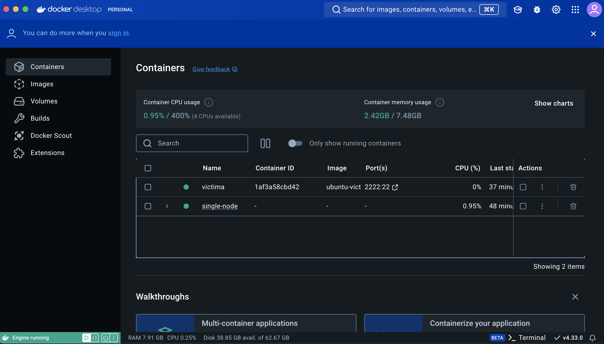
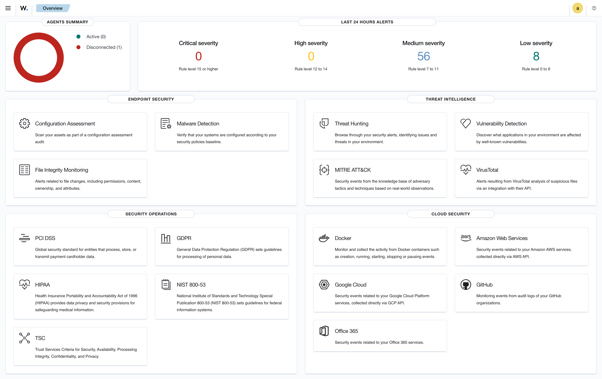

# Federico Volpintesta | Analista de Ciberseguridad & Desarrollador Full Stack

Profesional de IT que combina una sólida base técnica en desarrollo de software (Python, Django, React, PostgreSQL) con más de una década de experiencia en administración operativa, manejo de crisis y gestión de equipos.

Mi valor diferencial radica en mi capacidad para auditar y asegurar aplicaciones desde la perspectiva del código fuente, mientras aplico una visión de negocio madura para la gestión de riesgos y la respuesta a incidentes. Construyo soluciones escalables y garantizo su integridad mediante controles defensivos robustos.

---

## 🛠️ Stack Tecnológico y Habilidades

- **Seguridad & Operaciones:** Análisis de Logs, Hardening de Sistemas, Framework NIST, Gestión de Vulnerabilidades (OWASP Top 10), Linux, SIEM (Wazuh).
- **Desarrollo Web & Bases de Datos:** Python, JavaScript (Vanilla/React), Django, PostgreSQL, SQL, Supabase, Firebase.
- **Habilidades de Gestión:** Análisis de Riesgos corporativos, Continuidad de Negocio (BCP), Auditoría de Procesos, Liderazgo de Equipos.

---

## 📂 Proyectos Destacados

### 1. Investigación y Auditoría de Bases de Datos (SQL & Python)
- **Objetivo:** Detección proactiva de amenazas mediante el análisis de telemetría y registros de acceso.
- **Logros:**
  - Extracción y correlación de datos utilizando consultas SQL complejas para aislar intentos de inicio de sesión sospechosos basados en criterios de hora, fecha y ubicación geográfica.
  - Identificación de actividades anómalas fuera del horario laboral y segmentación de bases de datos de empleados para la planificación de actualizaciones de seguridad críticas.

### 2. Arquitectura de Seguridad y Hardening de Sistemas
- **Objetivo:** Evaluación de riesgos corporativos y despliegue de controles compensatorios para mitigar vulnerabilidades sistémicas.
- **Logros:**
  - Diseño de políticas de endurecimiento que incluyen la configuración de reglas estrictas de filtrado de red en Firewalls (listas de control de acceso y filtrado de puertos).
  - Implementación y documentación de Autenticación Multifactor (MFA) para mitigar riesgos de credenciales compartidas.
  - Reestructuración de la Gestión de Identidades y Accesos (IAM) con políticas de contraseñas seguras y auditorías periódicas.

### 3. Respuesta a Incidentes y Framework NIST
- **Objetivo:** Estructuración táctica para la contención y mitigación de ciberataques en tiempo real.
- **Logros:**
  - Análisis e investigación de un ataque de Denegación de Servicio (DoS) provocado por una avalancha de paquetes ICMP entrantes.
  - Aplicación del Marco de Ciberseguridad del NIST (Identificar, Proteger, Detectar, Responder y Recuperar) para estructurar la respuesta técnica y operativa.
  - Diseño de estrategias de contención rápida, como el aislamiento de sistemas afectados, neutralización de servicios no críticos y despliegue de reglas de rate limiting e IDS/IPS preventivos.

### 4. Análisis de Tráfico de Red (tcpdump) y Controles de Seguridad
- **Objetivo:** Inspección de paquetes a bajo nivel para el diagnóstico de interrupciones de servicio y fallos de conectividad.
- **Logros:** Análisis de logs de tcpdump identificando respuestas de error ICMP y bloqueos en el protocolo UDP (Puerto 53) durante la resolución DNS. Diseño de un plan de mitigación clasificando soluciones en Controles Técnicos (Firewalls/IDS), Administrativos y Físicos (preventivos, detectivos y correctivos).

### 5. Auditoría de Controles de Acceso y Gestión de Riesgos
- **Objetivo:** Evaluación de riesgos operativos, análisis de incidentes y aplicación del principio de privilegio mínimo (NIST AC-6).
- **Logros:**
  - Identificación y remediación de vulnerabilidades de autorización y ciclo de vida de identidades en sistemas.
  - Elaboración de una matriz de riesgos para priorizar vulnerabilidades frente a amenazas internas y externas.
  - Diseño de controles compensatorios técnicos y administrativos para prevenir la fuga de datos empresariales.

---

## 🛡️ Laboratorio SOC & Ethical Hacking: Detección de Fuerza Bruta (Hydra + Wazuh SIEM)

Ejercicio práctico de pruebas de penetración defensiva y monitoreo de seguridad en tiempo real utilizando un entorno aislado con contenedores Docker.

- **Topología:** SIEM Wazuh configurado en clúster monolítico + Contenedor Ubuntu víctima expuesto en el puerto SSH (`2222:22`) con capacidades de red habilitadas.
- **Fase Ofensiva (Red Teaming):** Ejecución de ataques de fuerza bruta mediante THC-Hydra orientados a vulnerar credenciales del servicio de autenticación.
- **Fase Defensiva (Blue Team):** Correlación de eventos de autenticación fallida (`unix_chkpwd`), registro de alertas críticas en el SIEM y mapeo bajo los estándares de cumplimiento y frameworks de intrusión.

---

## 📸 Evidencias del Laboratorio (Screenshots)

### 1. Simulación del Ataque (Hydra) y Análisis de Logs del Sistema

### 2. Despliegue de Infraestructura y Contenedores (Docker Desktop)

### 3. Monitoreo y Alertas en el SIEM (Wazuh Dashboard)

---

## 🌐 Experiencia Práctica en Desarrollo

Aporto una comprensión profunda de la arquitectura web habiendo construido e implementado múltiples aplicaciones en producción (sistemas de gestión, plataformas de reservas y dashboards analíticos con arquitecturas en la nube). Esta experiencia me permite auditar configuraciones de bases de datos relacionales y asegurar el flujo de datos desde el backend hasta el cliente final.

---

## 📬 Contacto

- **LinkedIn:** [linkedin.com/in/federico-volpintesta](https://linkedin.com/in/federico-volpintesta)
- **GitHub:** [github.com/federicovolpintesta-eng](https://github.com/federicovolpintesta-eng)
- **Email:** federicovolpintesta@gmail.com
